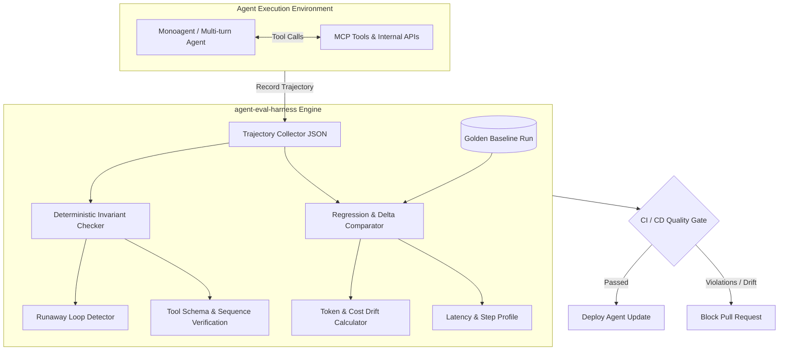

# `agent-eval-harness`

[](https://github.com/driasim/agent-eval-harness/actions)
[](https://www.python.org/downloads/)
[](https://opensource.org/licenses/MIT)

> **Production Regression Testing, Trajectory Evaluation, and Economic Drift Detection for LLM Agents.**

When you change an agent's system prompt, swap model weights (e.g. from `gpt-4o-2024-05-13` to `gpt-4o-2024-08-06`), or update tool definitions, **how do you know if the agent actually got better or worse?**

Traditional unit tests fail because agents are non-deterministic, multi-step state machines. Relying solely on LLM-as-a-judge is slow, noisy, and blind to tool execution loops or token cost explosions.

`agent-eval-harness` provides a **deterministic evaluation engine** that replays agent execution trajectories, verifies tool invocation graphs, detects runaway retry loops, and measures dollar-cost/latency drift before production deployment.

---

## 📐 Architecture Overview



---

## ⚡ Key Features

1. **Deterministic Trajectory Assertions:**
   - Assert exact tool sequences, prohibited tools (e.g. preventing unindexed raw SQL calls in production), and mandatory schema arguments.
2. **Entropy & Runaway Loop Detection:**
   - Detects tool invocation loops where agents repeatedly query endpoints with identical parameters after receiving partial or empty responses.
3. **Economic & Token Drift Auditing:**
   - Computes dollar-cost deltas and token usage inflation against golden runs.
4. **Golden Baseline Regression Diffing:**
   - Compare candidate trajectories against historical golden runs to catch subtle behavioral regressions.
5. **CI/CD Integration:**
   - Runs directly in GitHub Actions or pre-commit hooks to block bad prompts before they reach users.

---

## 🛠️ Quickstart

### Installation

```bash
git clone https://github.com/driasim/agent-eval-harness.git
cd agent-eval-harness
pip install -e .
```

### 1. Evaluate a Trajectory Against Invariants

```bash
agent-eval eval \
  --trajectory ./examples/candidate_regressed.json \
  --required-tools erp_lookup_vendor,match_po_line_items \
  --prohibited-tools raw_sql_query \
  --max-cost 0.010
```

### 2. Compare Candidate Against Golden Baseline (Regression Diff)

```bash
agent-eval compare \
  --baseline ./examples/baseline_crm.json \
  --candidate ./examples/candidate_regressed.json
```

### 3. Run Sample Demo Script

```bash
python examples/run_sample_eval.py
```

---

## 📊 Sample Output: Regression Diff

```text
┏━━━━━━━━━━━━━━━━━━━━━━┳━━━━━━━━━━━━━━━━━┳━━━━━━━━━━━━━━━━━━━━┳━━━━━━━━━━━━━━━━━━━━━━━━┓
┃ Dimension            ┃ Baseline (v1.4) ┃ Candidate (v1.5)   ┃ Delta / Impact         ┃
┡━━━━━━━━━━━━━━━━━━━━━━╇━━━━━━━━━━━━━━━━━╇━━━━━━━━━━━━━━━━━━━━╇━━━━━━━━━━━━━━━━━━━━━━━━┩
│ Estimated Cost       │ $0.00618        │ $0.01515           │ +$0.00897 (+145.3% drift)
│ Total Tokens         │ 2095            │ 5280               │ +3185 tokens           │
│ Execution Latency    │ 680.0ms         │ 2350.0ms           │ +1670.0ms              │
│ Tool Execution Graph │ Golden Path     │ Diverged (Raw SQL) │ REGRESSION DETECTED    │
└──────────────────────┴─────────────────┴────────────────────┴────────────────────────┘

❌ Regressions Introduced:
 - [prohibited_tool_called] Prohibited tool 'raw_sql_query' was called during step 2.
 - [tool_called_min] Tool 'match_po_line_items' was expected at least 1 time(s), but called 0 time(s).
 - [cost_budget_exceeded] Cost $0.01515 exceeded budget of $0.010
```

---

## 🧠 Production Lessons & Philosophy

* **Why not just use LLM-as-a-judge?**
  LLM judges are great for subjective tone, but terrible at asserting that an ERP reconciliation tool was called with `status=MATCHED` instead of `status=PENDING`. In production, 80% of regressions are deterministic tool signature breaks, schema mismatches, or cost drift.
* **Token drift is an early warning system:**
  When an agent's token usage climbs 40% on identical scenarios without an improvement in task completion, it is usually struggling with prompt ambiguity or getting confused by updated system instructions.

---

## 📄 License
MIT © Ibrahim Aliyu Saddique (`@driasim`)
